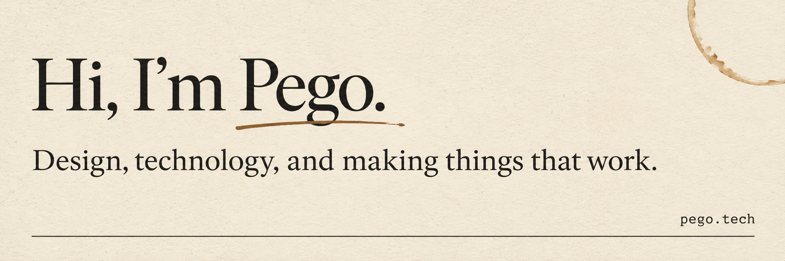

I'm Massimo Pegoraro, a technology director, co-founder and developer based in Italy.

Over the past 20 years, I've built web applications, helped grow two studios and led an engineering team of around 30 developers. My work has taken me through digital commerce, connected devices and technology leadership at Atoms, Retex and Design Group Italia.

I still write code. These days, I'm particularly interested in how AI agents work with codebases, retain context and fit into a team's development process.

[Pego's Desk](https://pego.tech/) · [About & track record](https://pego.tech/about/) · [LinkedIn](https://www.linkedin.com/in/massimopegoraro/)

## On the desk

- **AI-native commerce:** what happens when the interface moves beyond the website.
- **Composable platforms:** architecture that holds up through migration and everyday operations.
- **Agentic workflows:** coding agents, useful context and real operational work.
- **Engineering organisations:** teams that keep their knowledge and can make decisions through change.

## In the open

- [6phase](https://github.com/pego/6phase) — A development workflow for AI coding agents, covering design, planning, implementation, review, documentation and commits.

- [Twin-Mind](https://github.com/pego/twin-mind) — Codebase search and persistent memory for AI coding agents, with local notes and shared team decisions.

- [Pego's Desk](https://pego.tech/) — My collection of tools, articles, repositories and research on technology, AI and design, with notes on what caught my attention and where it might be useful.

## Built along the way

| Year | Company | Role | Description |
| --- | --- | --- | --- |
| 2025 | Design Group Italia | **Tech director** | Led technology at Design Group Italia, a multidisciplinary design studio within Alkemy+. Took on the role during the Retex–Alkemy integration, as Atoms’ experience design capabilities became part of the studio. |
| 2021 | Retex | **Tech director** | Led an engineering team of around 30 developers following Retex’s acquisition of Atoms in 2021. Oversaw architecture and delivery for international fashion and luxury commerce programmes, including composable replatforming, systems integrations and multi-market rollouts. Led the adoption of AI tools in software engineering workflows. |
| 2018 | Atoms | **Co-Founder & Technical Director** | Co-founded and helped grow a digital experience studio from 15 to 40 people. Led technology and delivery for e-commerce and digital experience projects, and introduced headless and composable architectures. One example was Au Départ, whose e-commerce launch expanded to 22 additional markets. |

[The longer story →](https://pego.tech/about/)

## Useful beats impressive

**Simplify what is tangled.** Understand the problem well enough to make the system simpler.

**Keep the context that matters.** Preserve the decisions and knowledge that otherwise leave with people.

**Make the next decision easier.** Give the team enough clarity to move without me in the room.

## Bring the messy version

Platform and product strategy, technical due diligence, or AI-native commerce? Tell me what you're working on, what you'd want from me, and any timing that matters.

[Talk](https://pego.tech/talk/) · [hi@pego.tech](mailto:hi@pego.tech)
