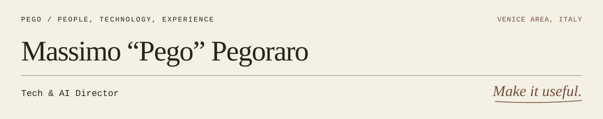

<picture>
  <source media="(prefers-color-scheme: dark)" srcset="assets/profile-header-dark.svg">
  <source media="(prefers-color-scheme: light)" srcset="assets/profile-header.svg">
  
</picture>

I'm **Massimo Pegoraro**, usually **Pego**. I'm Tech & AI Director at **Alkemy Group**, working on luxury commerce and the engineering organisations behind it.

Before that, I co-founded **DiGiness** and **Atoms** and wrote the code myself. Twenty-plus years in, I still work across platforms, products and the people who own them.

[Pego's Desk](https://pego.tech/) · [About & track record](https://pego.tech/about/) · [LinkedIn](https://www.linkedin.com/in/massimopegoraro/)

## On the desk

- **AI-native commerce:** what happens when the interface moves beyond the website.
- **Composable platforms:** architecture that holds up through migration and everyday operations.
- **Agentic workflows:** coding agents, useful context and real operational work.
- **Engineering organisations:** teams that keep their knowledge and can make decisions through change.

## In the open

Two projects here reflect the same concerns I bring to teams: how work gets done, and how context survives.

**[6phase](https://github.com/pego/6phase)** — A six-phase workflow for AI coding agents, from design and planning through approval, documentation and commit.

**[twin-mind](https://github.com/pego/twin-mind)** — Codebase knowledge and conversation memory for AI coding agents, with shared team decisions.

I also keep **[Pego's Desk](https://pego.tech/)**: tools, ideas and notes on design, technology and making things work. Collected with care, selected for practical use.

## Built along the way

| Year | Work | Scale / outcome |
| --- | --- | --- |
| 2016 · DiGiness | **Candy · Haier Group** | IoT platform work for **4.5 million connected appliances**. |
| 2021 · Atoms | **e1972** | A sizeless commerce experience using **AI full-body scanning**. |
| 2024 · Alkemy Group | **Global brand, name withheld** | Global e-commerce across **60 countries**, with **€150 million in revenues**. |

[The longer story →](https://pego.tech/about/)

## Useful beats impressive

**Simplify what is tangled.** Understand the problem well enough to make the system simpler.

**Keep the context that matters.** Preserve the decisions and knowledge that otherwise leave with people.

**Make the next decision easier.** Give the team enough clarity to move without me in the room.

## Bring the messy version

Platform and product strategy, technical due diligence, or AI-native commerce? Tell me what you're working on, what you'd want from me, and any timing that matters.

[Talk](https://pego.tech/talk/) · [hi@pego.tech](mailto:hi@pego.tech)
